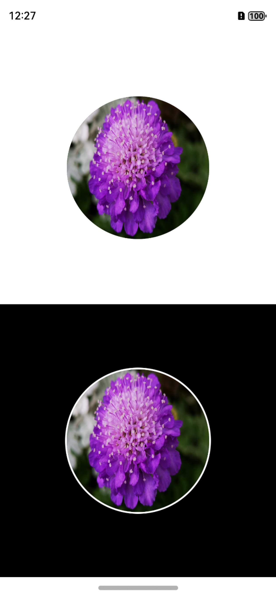

<div align="center">
<h1>circleImageView4cj</h1>
</div>

<p align="center">


</p>

## 介绍

circleImageView4cj 是一个图片处理的库，可以将图片裁剪为圆形或者给图片设置边框。

<p align="left">

</p>

## 特性

- 支持图片中心裁剪的缩放方式
- 支持圆形边框设置

### 源码目录

```shell
├─ AppScope
├─ doc        # API文档和使用手册存放目录                   
├─ entry      # 示例代码文件夹                  
├─ circleimageview    # circleimageview 库文件夹                   
│  └─ src
│      └─ main
│          ├─ cangjie                                 
│          │      └─ circle_image_view.cj      # 自定义图片裁剪
│          └─ resources
├─ hvigor  # 构建工具目录
└─ README.md  # circleImageView4cj 介绍及使用说明   
```
## 接口说明

主要类和函数接口说明详见 [API](doc/feature_api.md)

## 使用说明

1. 通过 module 引入
    1. 克隆下载项目
    2. 将 circleImageView4cj 模块拷贝到应用项目下
    3. 修改自身应用 entry 下的 oh-package.json5 文件，在 dependencies 字段添加 "circleimageview": "file:../circleimageview"
      ```json
      {
         "name": "entry",
         "version": "1.0.0",
         "description": "Please describe the basic information.",
         "main": "",
         "author": "",
         "license": "",
        "dependencies": {
            "circleimageview": "file:../circleimageview"
        }
      }
      ```
    4. 修改自身应用 entry 下的 cjpm.toml 文件，在 [dependencies] 字段下添加：
       ```toml
       [dependencies]
           circleimageview = {path = "../circleimageview", version = "1.0.0"}
       ```
    5. 在项目中使用 import circleimageview.* 引用 circleimageview 项目
       ```cangjie
       import circleimageview.*
       ```
2. 把 circleImageView4cj 作为三方库依赖引入
    1. 目标工程把 circleImageView4cj 依赖库作为 git submodule 引入

    ```
    > cd $工程根目录
    > mkdir third-party
    > cd third-party
    > git submodule add "https://gitcode.com/Cangjie-TPC/circleImageView4cj.git"
    ```
    2. 修改自身应用 entry 下的 cjpm.toml 文件，添加依赖
    ```toml
    [dependencies]
        circleimageview = {path = "../third-party/circleImageView4cj", version = "1.0.0"}
     ```
    3. 在项目中使用 circleimageview 组件
       ```cangjie
       import circleimageview.*
       ```

## 功能示例

详见 `entry`

```cangjie
import ohos.base.*
import ohos.component.*
import ohos.state_manage.*
import ohos.state_macro_manage.*
import circleimageview.*

@Entry
@Component
class EntryView {
    @State
    var data: CircleImageModel = CircleImageModel()

    protected override func aboutToAppear() {
        this.data = this.data.setImageURI(@r(app.media.hugh)).setDiameter(200.0).setBorderWidth(5.0).setBorderColor(
            Color.WHITE).setScaleType(ImageFit.Fill).setDisableCircularTransformation(false)
    }
    func build() {
        Column() {
            List(space: 0, initialIndex: 0) {
                ListItem() {
                    Column(5) {
                        CircleImageView(model: data)
                    }.align(Alignment.Center).width(200).height(200)
                }.height(50.percent).width(100.percent)

                ListItem() {
                    Column(5) {
                        CircleImageView(model: data)
                    }.align(Alignment.Center)
                }.height(50.percent).backgroundColor(0x000000).width(100.percent)
            }.width(100.percent).margin(top: 5)
        }
    }
}
```


## 约束与限制

在下述版本验证通过：

    DevEco Studio 5.1.1 Release(5.1.1.840)

## 开源协议

本项目基于 [Apache License 2.0](./LICENSE)，请自由的享受和参与开源。

## 参与贡献

欢迎给我们提交PR，欢迎给我们提交Issue，欢迎参与任何形式的贡献。
